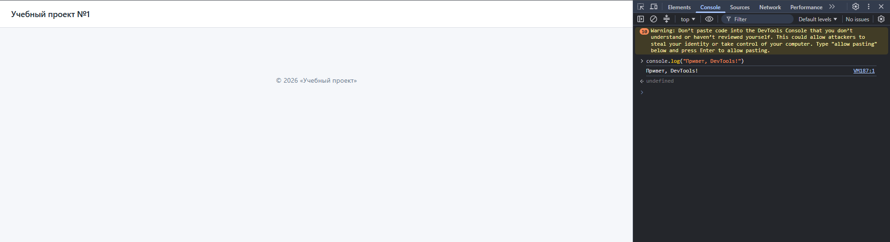

## Лабораторная работа №1

### Краткий отчёт

В ходе лабораторной работы были установлены и настроены Node.js, Visual Studio Code и Git. Успешно проверены версии установленных программ и выполнена установка зависимостей проекта через npm. Все этапы работы выполнены, поставленная цель достигнута.

### Скриншот DevTools (вкладка Console).
